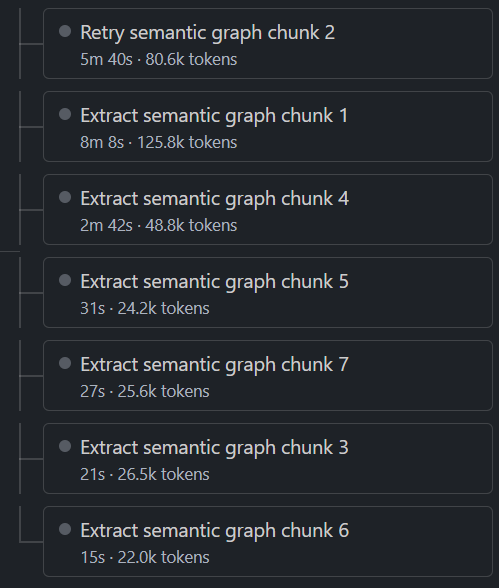

<div dir="rtl">

[English](README.md) | فارسی

# مولتی‌ایجنت پایپ‌لاین برای کلود کد

کلود کد را به یک تیم توسعه‌ی مولتی‌ایجنت خودکار تبدیل کنید. با یک دستور، کل چرخه‌ی ساخت اجرا می‌شود: **معماری** طراحی می‌کند، **کدنویس** پیاده‌سازی می‌کند، **بازبین** راستی‌آزمایی می‌کند و **سنیور** در بن‌بست‌ها ریشه‌یابی و رفع می‌کند — بدون نیاز به نظارت مداوم.



## چرا این ابزار؟

در حلقه‌های معمول تک‌ایجنتی، مدلی که طراحی می‌کند همان مدلی است که کد می‌نویسد و همان که بازبینی می‌کند؛ نتیجه این می‌شود که انحراف از هدف هیچ‌وقت دیده نمی‌شود. این پلاگین نقش‌ها را به چهار ساب‌ایجنت تخصصی جدا می‌کند که با یک ماشین حالت سخت‌گیرانه به هم گره خورده‌اند. و با قابلیت **کامبو** در [9router](https://github.com/decolua/9router) می‌توانید به هر نقش یک مدل جدا بدهید — مدل قوی برای جاهایی که قضاوت مهم است و مدل ارزان یا رایگان برای جاهایی که سرعت مهم است.

## نصب

```
/plugin marketplace add YOUR_GITHUB_USERNAME/multi-agent-pipeline
/plugin install multi-agent-pipeline@multi-agent-pipeline
```

## شروع سریع

در هر پروژه:

```
/multi-agent-pipeline:pipeline یک بازی مار با HTML canvas و ذخیره‌ی رکورد در localStorage بساز
```

اتفاقی که می‌افتد:

1. در اولین اجرا، پروتکل داخل `CLAUDE.md` پروژه‌ی شما ساخته می‌شود
2. معماری → تولید `TASKS.md` (معماری، تسک‌ها، معیارهای پذیرش)
3. برای هر تسک: کدنویس → بازبین؛ اگر `STATUS: REJECTED` بیاید، با اصلاحات دقیق بازبین تکرار می‌شود
4. بعد از ۳ رد متوالی روی یک تسک، ایجنت سنیور وارد عمل می‌شود
5. توقف فقط در `ALL_TASKS_COMPLETE` یا `PIPELINE_FATAL_ERROR`

## تیم

| ایجنت | نقش | مدل پیش‌فرض | قرارداد خروجی |
|---|---|---|---|
| architect | طراحی سیستم، تقسیم کار، تولید `TASKS.md` | inherit (مدل اصلی شما) | `ARCHITECTURE_READY` |
| coder | پیاده‌سازی فقط تسک فعال | sonnet | `IMPLEMENTATION_COMPLETE` |
| code-reviewer | راستی‌آزمایی بر اساس معیارهای پذیرش | inherit | `STATUS: APPROVED` / `STATUS: REJECTED` |
| senior | ریشه‌یابی و رفع بن‌بست بعد از ۳ رد متوالی | opus | `ROOT_CAUSE` / `DECISION` / `REQUIRED_CHANGES` |

## چطور کار می‌کند (ماشین حالت)

```
PLANNING → CODING → REVIEWING ─┬─ APPROVED → تسک بعدی → ... → ALL_TASKS_COMPLETE
                               └─ REJECTED → RETRYING ─┬─ (رد سوم) → ESCALATING → ...
```

پروتکل به‌صورت یک اسکیل (`pipeline-protocol`) و یک کامند (`pipeline`) عرضه می‌شود و در `CLAUDE.md` پروژه هم منعکس می‌شود تا همه‌ی ایجنت‌ها قواعد یکسانی بخوانند.

## مدل جدا برای هر ایجنت (پیشرفته)

به‌صورت پیش‌فرض همه‌چیز با aliasهای استاندارد مدل در کلود کد کار می‌کند. برای اینکه هر ایجنت به مدل‌های متفاوت، ارزان‌تر یا رایگان از طریق قابلیت **کامبو** در 9router وصل شود، [راهنمای 9router](docs/9router-combo.md) را ببینید.

## مجوزها و امنیت

- فیلد `permissionMode` ایجنت‌های پلاگینی به‌صورت عمدی توسط کلود کد نادیده گرفته می‌شود. ایجنت معماری از طریق لیست ابزارهایش (Read/Glob/Grep/Web) عملاً فقط‌خواندنی است؛ کدنویس و سنیور می‌توانند فایل بنویسند و دستور اجرا کنند.
- آن را در پروژه‌ای اجرا کنید که به آن اعتماد دارید، از یک وضعیت تمیز گیت شروع کنید تا دیف‌ها قابل بازبینی بمانند، و اگر کلید توقف می‌خواهید، پرامپت‌های مجوز حلقه‌ی اصلی را روشن نگه دارید.
- «خودکار» به معنای «بی‌نظارت» نیست: پایپ‌لاین هیچ سؤالی نمی‌پرسد، پس نتیجه را مثل یک پول‌ریکوئست بازبینی کنید.

## شخصی‌سازی

ریپو را فورک کنید، فایل‌های `plugins/multi-agent-pipeline/agents/*.md` را ویرایش کنید (مدل‌ها، ابزارها، پرامپت‌ها) و از فورک خودتان نصب کنید. همه‌چیز مارک‌داون ساده است — بدون مرحله‌ی build.

## سؤالات متداول

**بدون 9router هم کار می‌کند؟**
بله — با مدل‌های استاندارد کلود کد. 9router اختیاری است و فقط برای مسیریابی چندمدلی.

**`TASKS.md` از کجا می‌آید؟**
ایجنت معماری در اولین اجرا آن را در ریشه‌ی پروژه می‌سازد.

**می‌توانم فقط بخشی از تیم را استفاده کنم؟**
بله — ایجنت‌ها به‌صورت تکی هم کار می‌کنند (از طریق `/agents`)، اما پروتکل پایپ‌لاین است که آن‌ها را به هم گره می‌زند.

## مجوز

MIT

</div>
