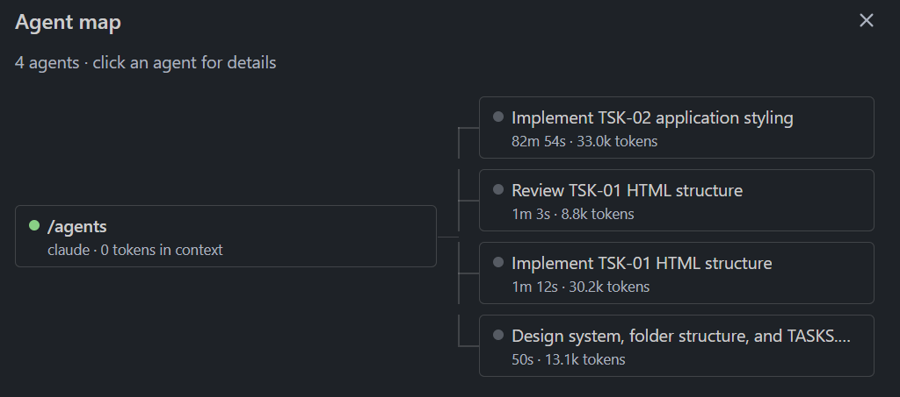
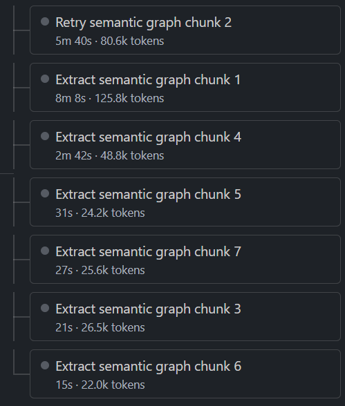

# Multi-Agent Pipeline for Claude Code

English | [مستندات فارسی](README.fa.md)

Turns Claude Code into a **multi-agent, multi-model — and free** coding team.
One short command runs a full autonomous build pipeline: the **architect**
plans, the **coder** implements, the **code-reviewer** verifies, and the
**senior** agent unblocks deadlocks — no babysitting required.

Through [9router](https://github.com/decolua/9router) combos, every agent can
run on a different model — including completely free ones.





## Install

```
/plugin marketplace add YOUR_GITHUB_USERNAME/multi-agent-pipeline
/plugin install pipeline@multi-agent-pipeline
```

## Quick start

In any project:

```
/pipeline:team Build a snake game with HTML canvas and localStorage high scores
```

Run it without arguments and it will ask you what to build.

What happens:

1. On first run, the protocol is scaffolded into your project's `CLAUDE.md`
2. architect → produces `TASKS.md` (architecture, tasks, acceptance criteria)
3. For each task: coder → code-reviewer; `STATUS: REJECTED` means a retry
   with the reviewer's exact fixes
4. After 3 consecutive rejections on one task, the senior agent escalates
5. Stops only at `ALL_TASKS_COMPLETE` or `PIPELINE_FATAL_ERROR`

## The team

| Agent | Role | Default model | Output contract |
|---|---|---|---|
| architect | system design, task decomposition, `TASKS.md` | inherit (your main model) | `ARCHITECTURE_READY` |
| coder | implements only the active task | sonnet | `IMPLEMENTATION_COMPLETE` |
| code-reviewer | verifies against acceptance criteria | inherit | `STATUS: APPROVED` / `STATUS: REJECTED` |
| senior | root-cause escalation after 3 rejections | opus | `ROOT_CAUSE` / `DECISION` / `REQUIRED_CHANGES` |

## How it works (state machine)

```
PLANNING → CODING → REVIEWING ─┬─ APPROVED → next task → ... → ALL_TASKS_COMPLETE
                               └─ REJECTED → RETRYING ─┬─ (3rd rejection) → ESCALATING → ...
```

The protocol ships as a skill (`pipeline-protocol`) plus a slash command
(`team` → `/pipeline:team`), and is mirrored into your project's `CLAUDE.md` so
every agent reads the same rules.

## Make it multi-model (and free) with 9router

The plugin works with plain Claude Code out of the box. To give each agent a
different model — or run the whole team on free models:

1. Install 9router and open the dashboard (`npm i -g 9router`, then
   `9router` → `http://localhost:20128`)
2. Dashboard → **CLI Tools** → **Claude Code** — 9router writes the config
   for you (`ANTHROPIC_BASE_URL`, `ANTHROPIC_AUTH_TOKEN`, and the
   `ANTHROPIC_DEFAULT_*_MODEL` alias remaps)
3. Dashboard → **Combos** → create two combos named exactly `sonnet` and
   `opus`, each an ordered list of models with a fallback strategy
4. Done — the agents' `model:` fields now route to your combos. Zero plugin
   edits.

Example: a free `sonnet` combo =
`zai-org/glm-4.7-flash → groq/gpt-oss-120b → ollama/glm-4.7-flash`; a
premium `opus` combo = your strongest reasoning model first.

Full guide: [docs/9router-combo.md](docs/9router-combo.md)

## Permissions & safety

- Plugin agents' `permissionMode` is ignored by Claude Code by design. The
  architect is read-only in practice via its tool allowlist
  (Read/Glob/Grep/Web); the coder and senior can write files and run
  commands.
- Run it in a project you trust, start from a clean git state so diffs stay
  reviewable, and keep your main-loop permission prompts on if you want a
  kill switch.
- Autonomous does not mean unattended: it never asks questions, so review
  the result like a pull request.

## Customization

Fork the repo, edit `plugins/pipeline/agents/*.md` (models, tools, prompts),
and install from your fork. Everything is plain Markdown — no build step.

## FAQ

**Does it work without 9router?**
Yes — with standard Claude Code models. 9router is optional, for multi-model
and free routing.

**Where does `TASKS.md` come from?**
The architect creates it in your project root on first run.

**Can I use only part of the team?**
Yes — the agents work individually too (see `/agents`), but the pipeline
protocol is what ties them together.

## License

MIT
